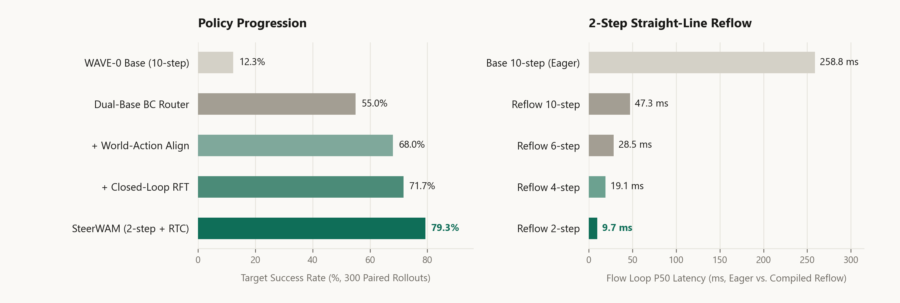

# SteerWAM: World-Action Model Post-Training and Inference Acceleration for Robotic Manipulation

**English** · [简体中文](README_zh.md) &nbsp;|&nbsp; Interactive Rollout Showcase: **[derrickll.github.io/SteerWAM](https://derrickll.github.io/SteerWAM/)**

## Summary

Built on the open-source **WAVE-0** architecture (PaliGemma VLM + latent world model + Flow Matching action expert), **SteerWAM** develops a single-backbone post-training and inference acceleration pipeline for dual-view robotic manipulation, validated across **940 paired MuJoCo rollouts** with strictly disjoint initial physics states:

- **World-Action Alignment**: Fixes post-action demonstration timestamp offsets via MuJoCo snapshot replay, mixes target/source trajectories (3:1), and injects LoRA into the last 10 PaliGemma layers while unfreezing the last 6 action expert layers under future `t+9` visual-latent and latent-action alignment losses.
- **Closed-Loop Rejection Fine-Tuning (RFT)**: Collects 200 multi-seed closed-loop rollouts to address contact slip in open-loop behavioral cloning; diagnoses why unbounded negative gradients in continuous `Flow-DPO` drift off narrow contact manifolds (42.0% Dev), and selects high-margin closed-loop chunks via RFT (82.0% Dev).
- **2-Step Rectified Flow & Inference Acceleration**: Combines `torch.compile` and 1-Rectified Flow distillation to compress 10-step Euler denoising into 2 straight-line steps (**258.8 ms -> 9.7 ms** flow loop P50; **415.9 ms -> 157.3 ms** full chunk P50), reduces few-step end-effector jerk by **30%** vs. unguided inference via step-adaptive RTC prefix guidance, and cuts resident VRAM from **17.8 GiB to 9.9 GiB** by replacing dual-model routing with single-backbone LoRA semantic routing.

| Evaluation&nbsp;Track | WAVE&#8209;0&nbsp;Base | SteerWAM | Net&nbsp;Gain&nbsp;[95%&nbsp;CI] | Rescue&nbsp;/&nbsp;Harm | Source&nbsp;Retention |
| :--- | :---: | :---: | :---: | :---: | :---: |
| **Development**&nbsp;(90) | 18.0%&nbsp;(9/50) | **76.0%**&nbsp;(38/50) | +58.0&nbsp;pp&nbsp;[+40.0,&nbsp;+76.0] | 29&nbsp;/&nbsp;0 | 100.0%&nbsp;(40/40) |
| **Benchmark**&nbsp;(500) | 12.3%&nbsp;(37/300) | **79.3%**&nbsp;(238/300) | +67.0&nbsp;pp&nbsp;[+45.3,&nbsp;+86.0] | 201&nbsp;/&nbsp;0 | 96.5%&nbsp;(193/200) |
| **Held&#8209;Out&nbsp;Final**&nbsp;(350) | 12.7%&nbsp;(19/150) | **77.3%**&nbsp;(116/150) | +64.6&nbsp;pp&nbsp;[+42.0,&nbsp;+83.3] | 97&nbsp;/&nbsp;0 | 97.5%&nbsp;(195/200) |
| **Combined&nbsp;(940)** | 13.0%&nbsp;(65/500) | **78.4%**&nbsp;(392/500) | +65.4&nbsp;pp | **327&nbsp;/&nbsp;0** | 97.3%&nbsp;(428/440) |

On the 350-episode independent LIBERO test set, 8 of 10 target tasks reach >=80% success (3 reach 100%), source tasks retain 97.5%, and overall success reaches **88.9%** (311/350). Remaining failure cases concentrate on upright book insertion into the narrow front caddy slot (`STUDY_SCENE2`, 2/15) due to visual self-occlusion without force/tactile sensing.
