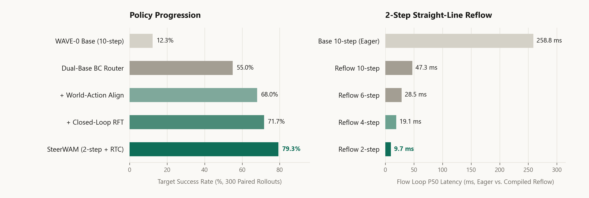

# 面向机械臂操作的 WAM 后训练与推理加速

[English](README.md) · **简体中文** &nbsp;|&nbsp; 在线交互演示主页：**[derrickll.github.io/SteerWAM/?lang=zh](https://derrickll.github.io/SteerWAM/?lang=zh)**

## 项目简介

基于开源 **WAVE-0** 世界-动作模型架构（PaliGemma 视觉-语言骨干 + 潜空间世界模型 + Flow Matching 动作专家），**SteerWAM** 构建面向双视角机械臂操作的单底座后训练与推理加速流程，并在初始物理状态严格隔离的 **940 组 MuJoCo 配对闭环评测** 中完成验证：

- **示范时序修复与世界模型特征对齐**：通过 MuJoCo 快照回放修复示范动作后观测的时序错位，按 3:1 混合采样新旧任务；在 PaliGemma 末 10 层注入 LoRA 并解冻动作专家末 6 层，引入第 `t+9` 帧视觉潜特征与潜动作对齐损失完成微调适配。
- **多初噪闭环采样与拒绝采样微调（RFT）**：针对开环行为克隆在接触操作中易滑脱的问题，基于多组初始噪声采集 200 条闭环 Rollout 轨迹；对比分析 `Flow-DPO` 在连续动作空间偏离专家分布的原因（开发集 42.0%），采用拒绝采样微调筛选高质量动作块（开发集 82.0%）。
- **两步 Rectified Flow 蒸馏与推理加速**：结合 `torch.compile` 与 Rectified Flow 将流去噪由未编译 10 步蒸馏压缩至 2 步（去噪循环中位耗时 **258.8 ms -> 9.7 ms**，整块动作推理 **415.9 ms -> 157.3 ms**）；改进步长自适应的 RTC 前缀引导策略，在少步推理消融中相比无引导使末端抖动 **降低 30%**；并通过单底座 LoRA 语义路由替代双模型路由，将常驻显存由 **17.8 GiB 降至 9.9 GiB**。

| 互斥评估集（回合数） | WAVE&#8209;0&nbsp;基线 | SteerWAM | 净提升&nbsp;[95%&nbsp;CI] | 救回&nbsp;/&nbsp;误伤 | 原任务保持率 |
| :--- | :---: | :---: | :---: | :---: | :---: |
| **开发验证集**&nbsp;(90) | 18.0%&nbsp;(9/50) | **76.0%**&nbsp;(38/50) | +58.0&nbsp;pp&nbsp;[+40.0,&nbsp;+76.0] | 29&nbsp;/&nbsp;0 | 100.0%&nbsp;(40/40) |
| **同初态配对集**&nbsp;(500) | 12.3%&nbsp;(37/300) | **79.3%**&nbsp;(238/300) | +67.0&nbsp;pp&nbsp;[+45.3,&nbsp;+86.0] | 201&nbsp;/&nbsp;0 | 96.5%&nbsp;(193/200) |
| **独立测试集**&nbsp;(350) | 12.7%&nbsp;(19/150) | **77.3%**&nbsp;(116/150) | +64.6&nbsp;pp&nbsp;[+42.0,&nbsp;+83.3] | 97&nbsp;/&nbsp;0 | 97.5%&nbsp;(195/200) |
| **合计&nbsp;(940)** | 13.0%&nbsp;(65/500) | **78.4%**&nbsp;(392/500) | +65.4&nbsp;pp | **327&nbsp;/&nbsp;0** | 97.3%&nbsp;(428/440) |

在 LIBERO 独立测试集 350 组配对闭环评测中，10 个新任务中 8 个达 80% 以上、3 个达 100%，原任务保持率 97.5%，综合成功率达 **88.9%**（311/350）。主要剩余失败集中在收纳盒前侧窄槽竖直插书任务（`STUDY_SCENE2`，2/15），受限于书体视觉自遮挡且缺乏腕部力/触觉反馈。
